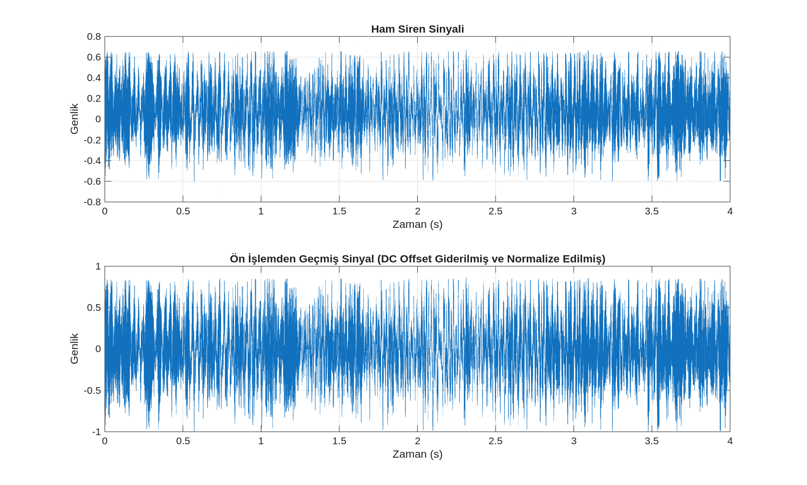
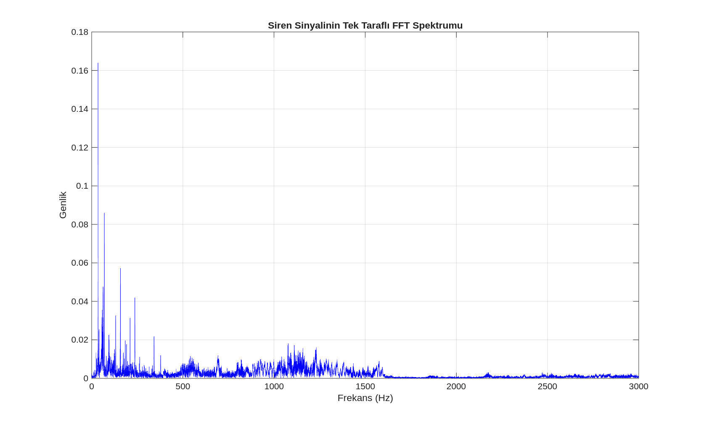
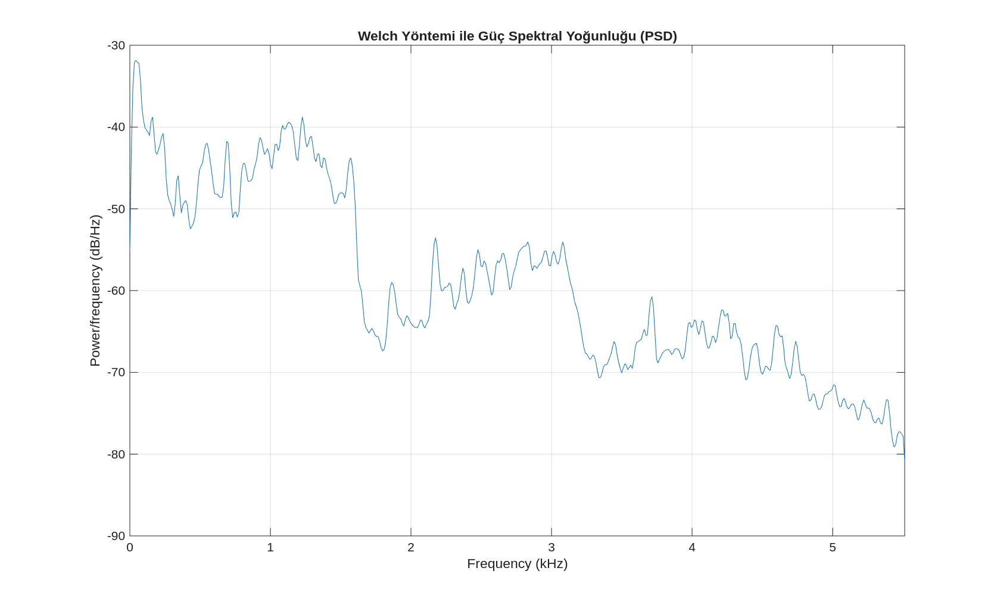
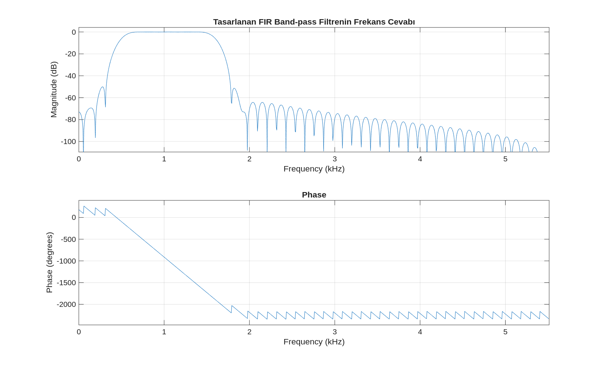
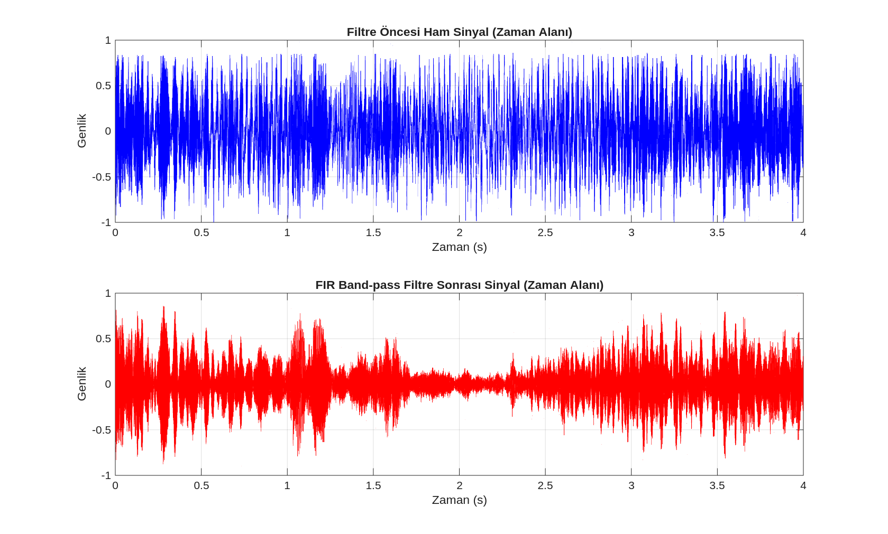
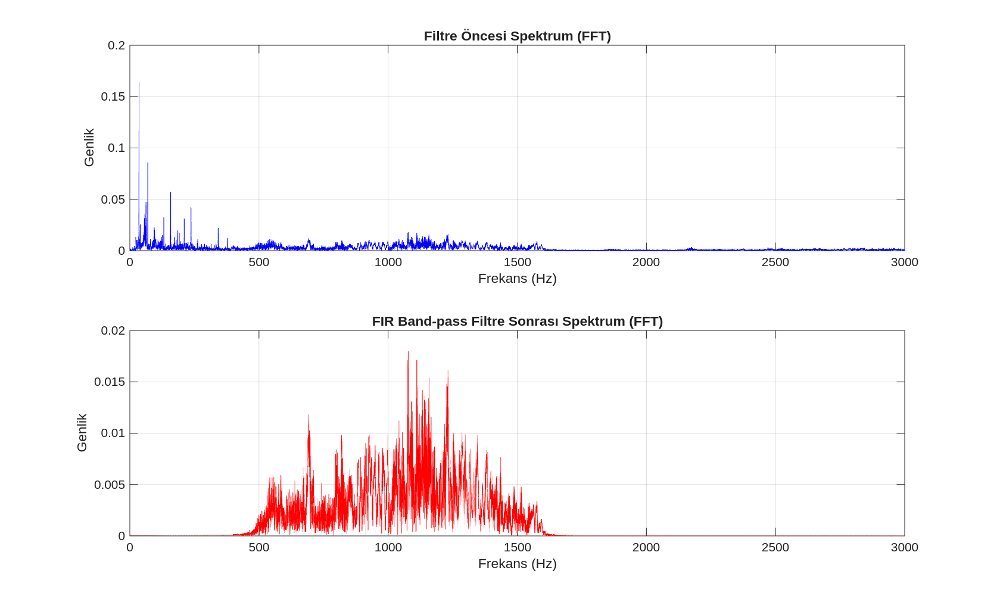
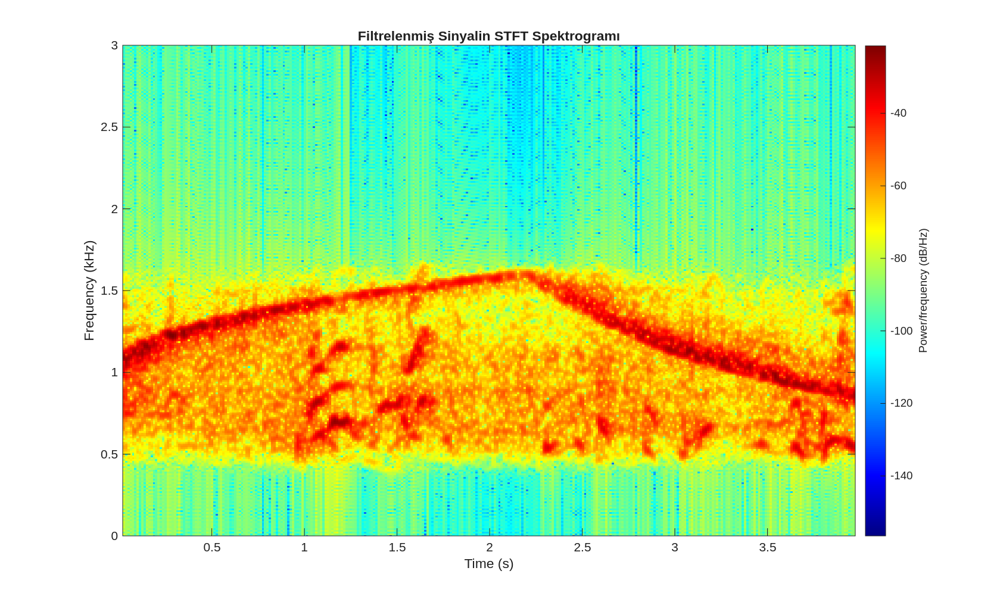
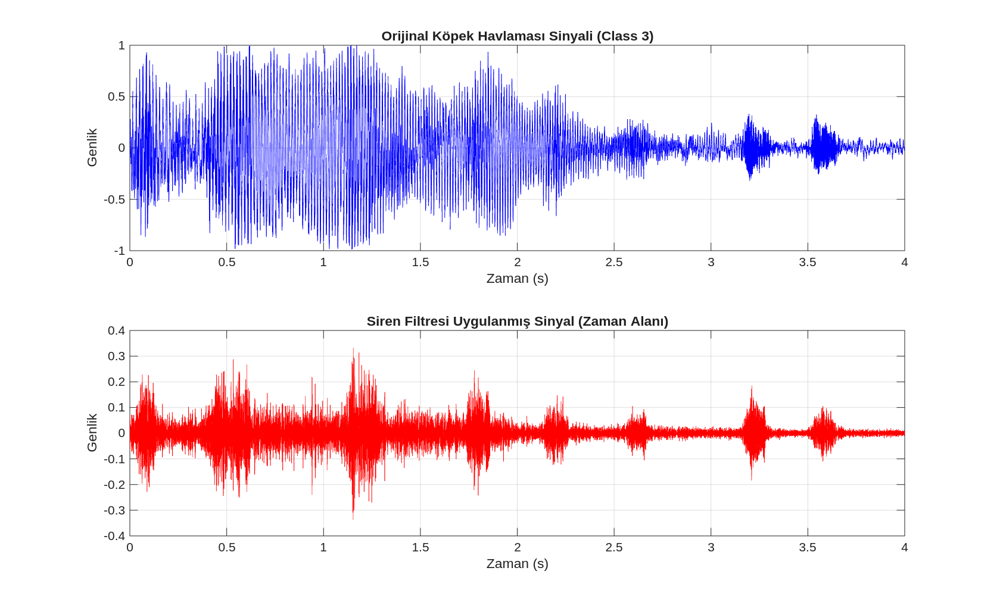
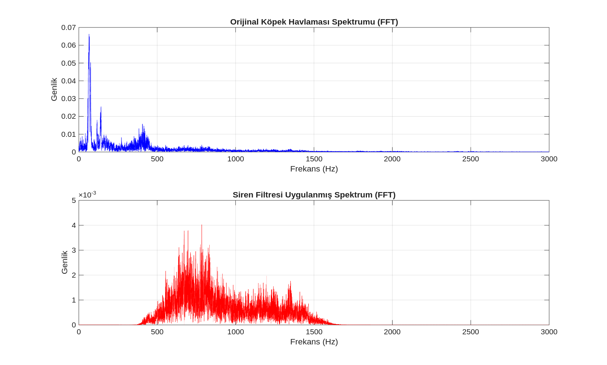

# Şehir Gürültüsünde Siren Sesi Analizi

Bu proje, UrbanSound8K veri setinden alınan bir siren kaydının sayısal işaret işleme yöntemleriyle incelenmesini ve filtrelenmesini amaçlar. Çalışmada zaman alanı, FFT, Welch güç spektral yoğunluğu (PSD), FIR bant geçiren filtre ve STFT/spektrogram analizleri uygulanır. Tasarlanan filtre ayrıca farklı örnekleme frekansına sahip bir köpek ses kaydı üzerinde test edilir.

## İçerik

```text
.
├── code/
│   ├── calistir_tum_adimlar.m
│   ├── adim01_veri_ve_onisleme.m
│   ├── adim02_fft_analizi.m
│   ├── adim03_psd_welch.m
│   ├── adim04_filtre_tasarimi.m
│   ├── adim05_karsilastirma.m
│   ├── adim06_stft_spektrogram.m
│   ├── adim07_farkli_ses_testi.m
│   └── grafik/
├── data/
│   ├── 40722-8-0-3.wav
│   └── 31323-3-0-2.wav
└── sinyal_isleme_final_raporu.pdf  # Yerel, depoya eklenmez
```

## Gereksinimler

- MATLAB
- Signal Processing Toolbox

`pwelch`, `fir1`, `filtfilt`, `freqz`, `spectrogram` ve `resample` fonksiyonları Signal Processing Toolbox kapsamında kullanılır. Kodlar GNU Octave üzerinde doğrulanmamıştır.

## Çalıştırma

Proje kök dizininden MATLAB komut penceresinde:

```matlab
cd('code')
calistir_tum_adimlar
```

Alternatif olarak `code` klasöründeki betikler aşağıdaki sırayla çalıştırılabilir:

```matlab
adim01_veri_ve_onisleme
adim02_fft_analizi
adim03_psd_welch
adim04_filtre_tasarimi
adim05_karsilastirma
adim06_stft_spektrogram
adim07_farkli_ses_testi
```

Betikler aynı MATLAB çalışma alanını kullanır. Bu nedenle ikinci listedeki sıra korunmalıdır. `calistir_tum_adimlar.m` bu sırayı otomatik olarak uygular ve çalışma dizinini `code` klasörüne alır.

## Yöntem

1. Siren kaydı yüklenir, stereo kayıtlar mono hâle getirilir, DC bileşen çıkarılır ve genlik normalize edilir.
2. Tek taraflı FFT ile frekans bileşenleri incelenir.
3. Welch yöntemiyle PSD hesaplanır.
4. `500–1600 Hz` geçirme bandına sahip, 100. dereceden FIR bant geçiren filtre tasarlanır.
5. Filtre `filtfilt` ile uygulanarak faz kayması azaltılır.
6. Filtre öncesi ve sonrası sinyaller zaman/frekans alanında karşılaştırılır.
7. Filtrelenmiş sinyalin STFT spektrogramı oluşturulur.
8. Aynı filtre, farklı örnekleme frekansına sahip köpek ses kaydına uygulanır.

## Veri

- `40722-8-0-3.wav`: UrbanSound8K siren sınıfından kayıt, 11.025 kHz, mono, 4 saniye.
- `31323-3-0-2.wav`: Farklı ses testi için kullanılan kayıt, 44.1 kHz, stereo, 4 saniye.

Veri seti: [UrbanSound8K](https://urbansounddataset.weebly.com/). Veri dosyalarının yeniden dağıtımı ve atıf koşulları için veri setinin güncel lisansını kontrol edin.

## Çıktılar

Analiz sonucunda oluşan grafikler [`code/grafik/`](./code/grafik/) klasörüne kaydedilir. Grafikler her çalıştırmada aynı dosya adlarıyla güncellenir.

## Analiz Sonuçları

Aşağıdaki görseller, projedeki MATLAB betiklerinin ürettiği analiz sonuçlarını
göstermektedir. Bu bölümde kişisel bilgi içeren rapor veya belge
kullanılmamıştır.

### Ön işleme ve spektrum analizi

Ham siren sinyali önce DC bileşeninden arındırılmış ve normalize edilmiştir.
Ardından sinyalin frekans içeriği FFT ve Welch PSD yöntemleriyle incelenmiştir.

<p align="center">
  
</p>

<p align="center">
  
</p>

<p align="center">
  
</p>

### FIR filtreleme

Siren sinyalinin baskın frekans bandını incelemek için 500–1600 Hz
aralığında 100. dereceden FIR bant geçiren filtre tasarlanmış ve
filtreleme öncesi/sonrası sonuçlar karşılaştırılmıştır.

<p align="center">
  
</p>

<p align="center">
  
</p>

<p align="center">
  
</p>

### Zaman-frekans ve farklı ses testi

STFT spektrogramı siren bileşenlerinin zaman içindeki değişimini göstermektedir.
Aynı filtre, farklı örnekleme frekansına sahip ikinci bir ses kaydına
uygulanarak ek bir test gerçekleştirilmiştir.

<p align="center">
  
</p>

<p align="center">
  
</p>

<p align="center">
  
</p>
